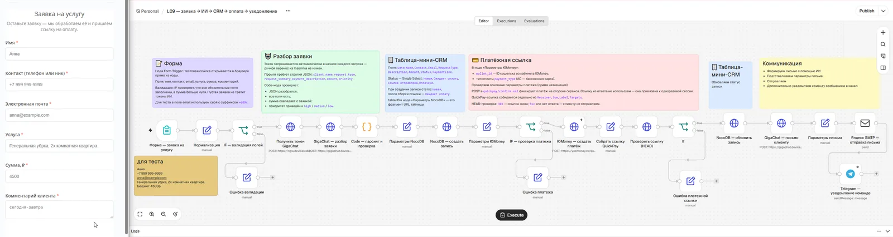
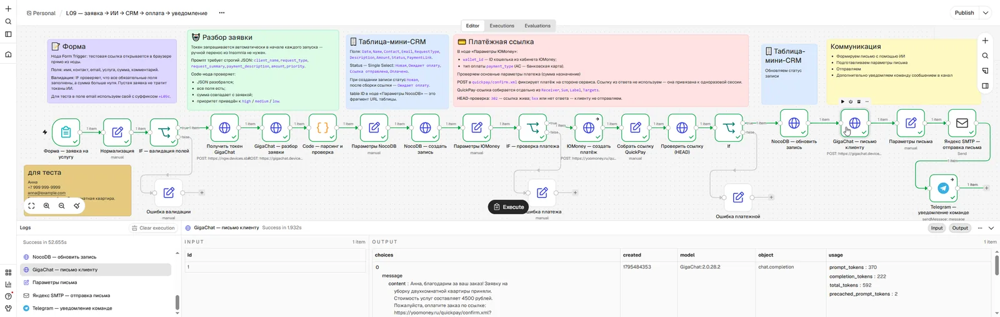
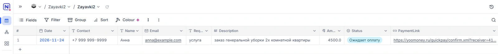
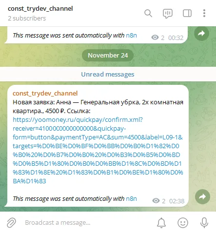

## Пример результата для проекта "Автоматизация обработки заявок в сервисной компании" (учебный кейс)

Ниже — снимки экрана учебного сценария:

- форма приёма заявки и схема сценария;
- выполненный сценарий и результат ноды с текстом письма;
- строка заявки в таблице после обновления статуса;
- уведомление менеджеру в Telegram.

📌 _Кликните уменьшенное изображение чтобы посмотреть полноразмерный скриншот_

| форма и схема ➡️ | выполнение ➡️ | таблица ➡️ | Telegram |
| ----------------------------- | ------------------------------ | ------------------------------ | ------------------------------ |
|  |  |  |  |

## Описание проекта

[README.md](README.md)
