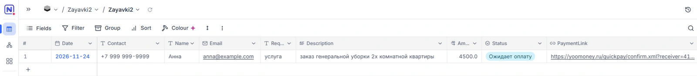

# Константин — автоматизация приёма заявок на n8n

**Контакты:** Telegram [@ConstRanger](https://t.me/ConstRanger) ·
e-mail [constranger@ya.ru](mailto:constranger@ya.ru) ·
GitHub [ConstRanger](https://github.com/ConstRanger)

## УТП

Настраиваю автоматизацию приёма заявок и уведомлений на n8n: клиент получает
ответ за минуты, заявки не теряются, оплата и статусы видны в одной таблице.

## Что кроме автоматизации

За плечами — разработка, тимлидство и управление IT-проектами в продуктовых
и сервисных компаниях. Поэтому автоматизацию рассматриваю как часть процесса,
а не как набор нод:

- сначала разбираюсь в задаче и требованиях, потом собираю решение;
- учитываю риски, интеграции и стоимость поддержки;
- довожу до документации и передачи команде.

## Кейс 1. Клининг: ответ за 2 минуты, 0 потерянных заявок

**До:** заявки в почте и чатах, ответ 30–60 минут, ручной перенос в таблицу,
часть обращений теряется.

**После:** форма → ИИ-разбор → таблица → платёжная ссылка → письмо и Telegram;
каждая заявка в единой базе, статус оплаты виден в записи.

**Результат:** ответ 1–2 минуты, 100% заявок зафиксировано, экономия около
5 часов в неделю.

[Подробный кейс](case.md) · [Скриншоты](screens.md)

## Что делаю

- приём заявок из форм, мессенджеров и почты;
- разбор и классификация обращений с помощью ИИ;
- учёт в таблицах и CRM, статусы и напоминания;
- платёжные ссылки и уведомления клиенту и менеджеру;
- контроль ошибок и ежедневные сводки.

## CTA

Напишите в [Telegram](https://t.me/ConstRanger) или на
[constranger@ya.ru](mailto:constranger@ya.ru) — разберём ваш процесс
и предложу, что автоматизировать в первую очередь.
